# Virtual Coffee Machine — Requirements v2

> Digital Twin · Domain-Driven Design · Version 2.0 · 2026-10-14

---

## 1. Overview

Version 2 builds on v1 by resolving three open questions and introducing a **Remote Configuration** domain. The machine can now receive recipe and threshold updates from an external configuration service, with a built-in default configuration as fallback.

### Changes from v1

| # | Area | Decision |
|---|---|---|
| OQ-3 resolved | Mid-brew exhaustion | Brewing stops immediately; machine enters ERROR state; partial brew is discarded |
| OQ-5 resolved | Waste tracking | Waste container is tracked by **brew count**, not volume |
| New | Configuration | Recipes and thresholds are remotely configurable; a default configuration is always present |

### Scope — Version 2 additions

| In scope | Out of scope |
|---|---|
| Remote configuration service integration | Authentication / authorisation on config API |
| Default configuration (built-in fallback) | Configuration history / versioning |
| Mid-brew ingredient exhaustion handling | Rollback of partial brews to physical state |
| Waste tracking by brew count | Multiple waste thresholds (warning vs full) |

---

## 2. Context Diagram

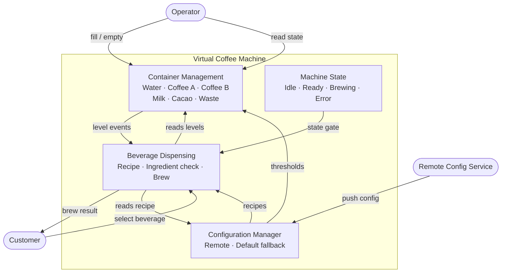

---

## 3. Containers

### Ingredient containers

| Container | Ingredient | Unit | Default low threshold | Max capacity |
|---|---|---|---|---|
| Water | Water | mL | 200 mL | 1 500 mL |
| Coffee A | Ground coffee type A | g | 20 g | 250 g |
| Coffee B | Ground coffee type B | g | 20 g | 250 g |
| Milk | Fresh milk | mL | 100 mL | 500 mL |
| Cacao | Cacao powder | g | 20 g | 200 g |

> Thresholds are configurable via the Remote Configuration domain (section 7). Default values are used when no remote config has been applied.

### Waste container

The waste container is tracked by **brew count** (number of brews since last emptied), not by volume.

| Property | Value |
|---|---|
| Unit | brews |
| Default full threshold | 10 brews |
| Reset by | Operator `emptyWasteContainer()` command |

> The full threshold is configurable via Remote Configuration.

### Container state model

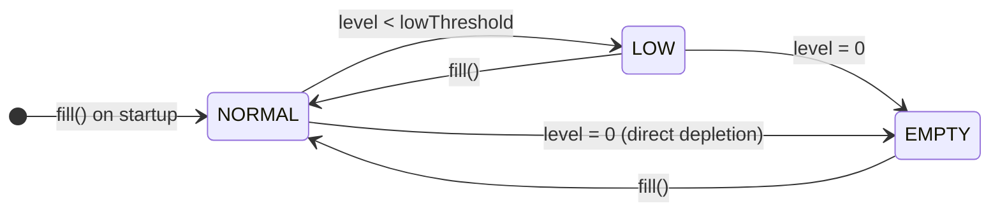

### Waste container state model

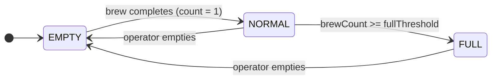

---

## 4. Machine State

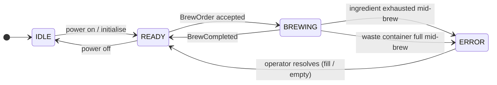

---

## 5. Remote Configuration

### 5.1 What is configurable

| Setting | Scope | Default |
|---|---|---|
| `lowThreshold` per container | Per container | See section 3 |
| `wasteFullThreshold` | Machine-wide | 10 brews |
| Recipe ingredient amounts | Per recipe | See section 6 |
| Beverage menu (enabled/disabled drinks) | Machine-wide | All enabled |

### 5.2 Default configuration

A **default configuration** is embedded in the machine. It is used:
- On first startup (before any remote config is received)
- When the remote config service is unreachable
- When a received config fails validation

The machine MUST NOT refuse to operate because the remote config service is unavailable.

### 5.3 Config update flow

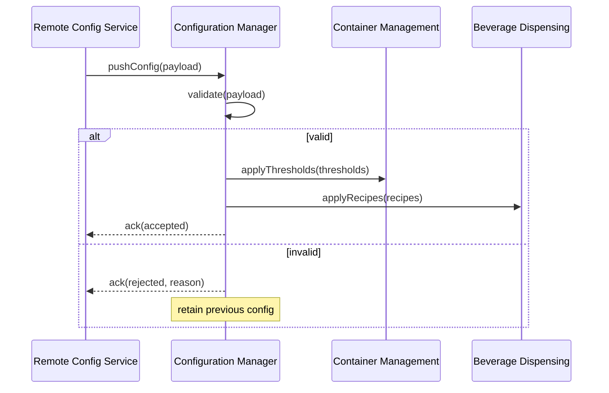

### 5.4 Configuration validation rules

- All threshold values must be positive numbers
- `lowThreshold` must be less than `maxCapacity` of the container
- `wasteFullThreshold` must be >= 1
- Every recipe must reference only known ingredients
- Ingredient amounts in a recipe must be positive

---

## 6. Beverage Menu and Recipes

Recipes are part of the configuration and can be updated remotely. The table below shows the **default** recipe values.

| Beverage | Water (mL) | Coffee A (g) | Coffee B (g) | Milk (mL) | Cacao (g) |
|---|---|---|---|---|---|
| Espresso | 30 | 7 | — | — | — |
| Americano | 120 | 7 | — | — | — |
| Cappuccino | 30 | 7 | — | 100 | — |
| Latte | 30 | 7 | — | 150 | — |
| Coffee B Espresso | 30 | — | 7 | — | — |
| Hot Chocolate | 150 | — | — | 100 | 20 |
| Mocha | 30 | 7 | — | 100 | 10 |

> Each brew increments the waste counter by 1, regardless of beverage type.

---

## 7. Behaviors

Behaviors B-01 through B-07 from v1 are retained. The following are added or updated.

### B-05 (updated) — Brew a beverage
When a beverage is confirmed, the machine SHALL:
1. Transition to BREWING state
2. Deduct ingredient amounts from the relevant containers **atomically** (all-or-nothing check before starting)
3. If any ingredient reaches zero **during** brewing, stop immediately and transition to ERROR
4. On successful completion: increment waste count by 1 and return to READY
5. If waste count reaches `wasteFullThreshold` after a brew, remain in READY but emit `WasteContainerFull`

### B-08 — Mid-brew ingredient exhaustion
If an ingredient is exhausted during brewing (level reaches 0 mid-process), the machine SHALL:
- Immediately stop the brew
- Transition to ERROR state
- Emit `BrewAborted(reason: ingredient, containerId)`
- Require operator intervention (fill the container) before accepting new orders

### B-09 — Apply remote configuration
When a valid configuration payload is received from the Remote Config Service, the machine SHALL apply thresholds and recipes without interrupting an in-progress brew. Changes take effect on the next brew order.

### B-10 — Fall back to default configuration
If the Remote Config Service is unreachable or returns an invalid payload, the machine SHALL continue operating with the last valid configuration (or the default configuration if none has been applied).

### B-11 — Read active configuration
An operator SHALL be able to query the currently active configuration (thresholds, recipes) and whether it originates from remote or default.

---

## 8. Scenarios

### S-01 — Successful espresso (happy path)

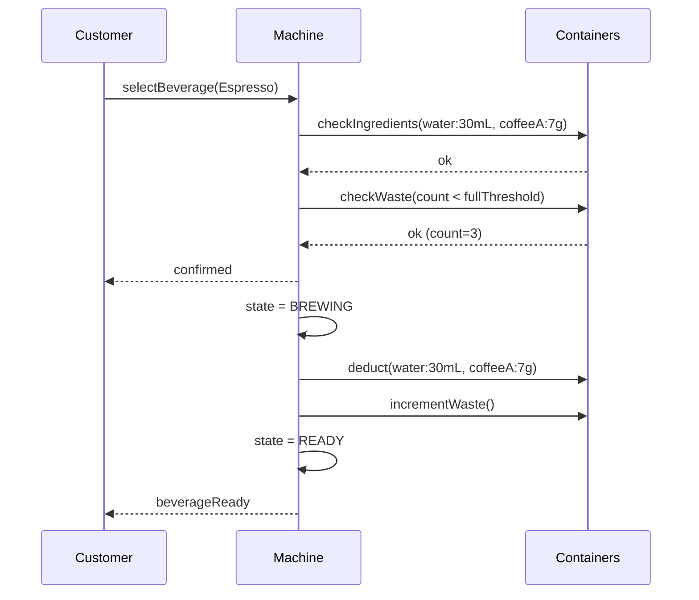

### S-02 — Rejection due to insufficient ingredient (pre-brew check)

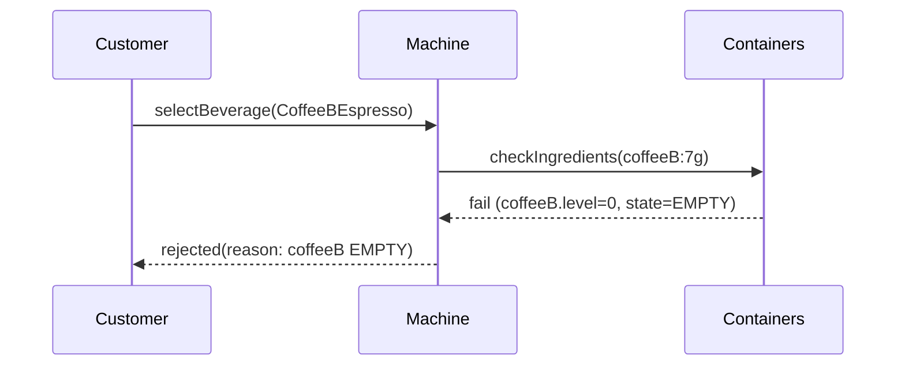

### S-03 — Mid-brew ingredient exhaustion

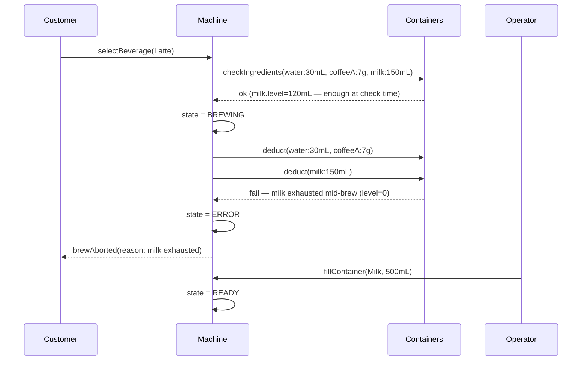

> Note: The water and coffee already deducted are consumed; the brew is not retried automatically.

### S-04 — Waste container full, brewing blocked

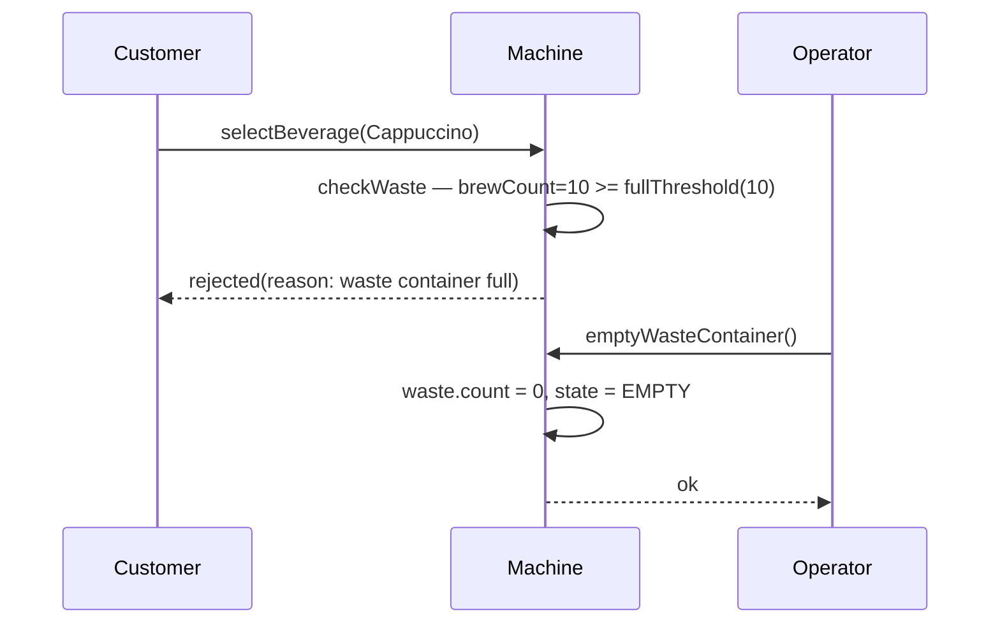

### S-05 — Remote config update accepted

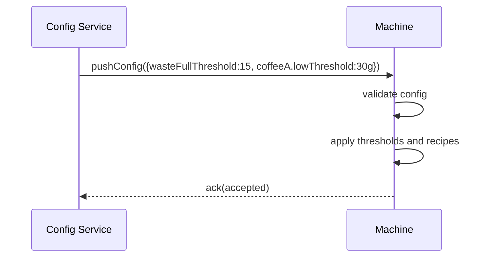

### S-06 — Remote config unreachable, fallback to default

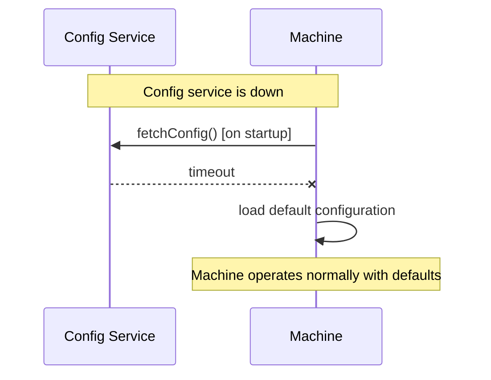

### S-07 — Operator reads active configuration

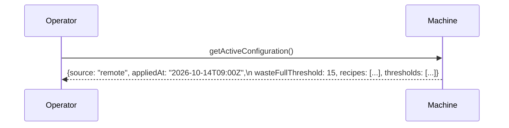

---

## 9. Domain Model — DDD (updated)

### 9.1 Context Map

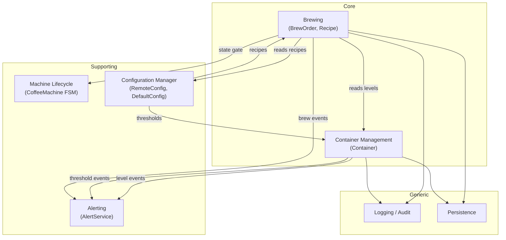

### 9.2 Core Domains

#### Brewing Domain
- **Aggregates:** `BrewOrder` (root), `Recipe`
- **Value Objects:** `Ingredient`, `Quantity`, `RecipeRequirement`
- **Domain Events:** `BeverageOrdered`, `BrewStarted`, `BrewCompleted`, `BrewAborted`, `BrewRejected`
- **Invariants:**
  - All ingredient checks pass before state transitions to BREWING
  - If any ingredient reaches 0 mid-brew, emit `BrewAborted` and transition machine to ERROR
  - Cannot start brew unless machine is READY

#### Container Management Domain
- **Aggregates:** `Container` (one per physical container), `WasteContainer`
- **Value Objects:** `ContainerLevel`, `ContainerState`, `BrewCount`
- **Domain Events:** `ContainerFilled`, `ContainerLow`, `ContainerEmpty`, `WasteContainerFull`, `WasteContainerEmptied`
- **Invariants:**
  - Ingredient container level is in range [0, maxCapacity]
  - Waste brew count is in range [0, fullThreshold]

### 9.3 Supporting Domains

#### Configuration Manager Domain *(new in v2)*
Owns the active configuration. Integrates with the Remote Config Service and always holds a valid config.

- **Aggregate:** `MachineConfiguration`
- **Value Objects:** `RecipeConfig`, `ThresholdConfig`, `ConfigSource` (REMOTE / DEFAULT)
- **Domain Events:** `ConfigurationApplied`, `ConfigurationRejected`, `ConfigurationFallback`
- **Invariants:**
  - A valid configuration is always present (default is the floor)
  - Config changes during a brew take effect on the next order, not the current one

#### Machine Lifecycle Domain
- **Aggregate:** `CoffeeMachine`
- **Value Object:** `MachineState` (IDLE / READY / BREWING / ERROR)
- **Domain Events:** `MachineReady`, `MachineBrewing`, `MachineError`, `MachineErrorResolved`

#### Alerting Domain
- **Service:** `AlertService`
- **Listens to:** `ContainerLow`, `ContainerEmpty`, `WasteContainerFull`, `BrewAborted`

### 9.4 Generic Domains

| Domain | Responsibility | v1 approach |
|---|---|---|
| Configuration | Storage of active config state | In-memory, loaded from embedded default JSON |
| Logging / Audit | Record all state changes and commands | Standard logging framework |
| Persistence | Store and retrieve aggregate state | In-memory store for v1/v2 |

---

## 10. Ubiquitous Language (updated)

| Term | Definition |
|---|---|
| **Container** | A storage unit holding one ingredient or waste |
| **Level** | Current amount in an ingredient container (mL or g) |
| **Brew Count** | Number of brews accumulated in the waste container since last emptied |
| **State** | Derived status: EMPTY / LOW / NORMAL for ingredients; EMPTY / NORMAL / FULL for waste |
| **Fill** | Operator action to set an ingredient container to a target level |
| **Empty** | Operator action to reset the waste container brew count to zero |
| **Recipe** | The set of ingredients and quantities required for one serving of a beverage |
| **Default Configuration** | Built-in recipe and threshold values; always present as a fallback |
| **Remote Configuration** | Recipe and threshold values pushed from an external config service |
| **BrewOrder** | A customer's intent to brew a beverage; transitions through the Brewing domain |
| **BrewAborted** | A brew that started but was stopped due to mid-brew ingredient exhaustion |
| **Operator** | A human who maintains the machine (fills ingredients, empties waste, monitors alerts) |
| **Customer** | A human who selects and receives a beverage |

---

## 11. Open Questions

| # | Question | Owner |
|---|---|---|
| OQ-4 | Will v3 add temperature as a dimension (hot water vs cold water tank)? | Architecture |
| OQ-6 | Should the Remote Config Service push (webhook) or be polled by the machine? | Architecture |
| OQ-7 | Is there a maximum config payload size or rate limit on config updates? | Infrastructure |
| OQ-8 | Should `BrewAborted` count toward the waste total (partial brew still produces waste)? | Domain expert |
| OQ-9 | Who is authorised to push a remote configuration — any caller, or is auth needed in v3? | Security |
