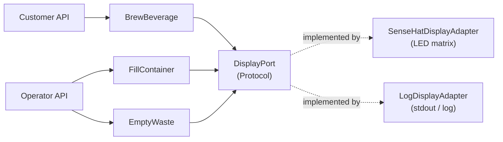

# Virtual Coffee Machine — Sense HAT Display Design

> Python · Ports & Adapters · Raspberry Pi Sense HAT · 2026-10-15

---

## 1. Goal

When the machine runs on a Raspberry Pi with a Sense HAT, the 8x8 LED matrix shows the customer what the machine is doing:

| Situation | Icon | Text | Duration |
|---|---|---|---|
| Ready (waiting for an order) | Coffee machine, blinking green power LED | `Welcome` | Until something happens |
| Brewing | Steaming coffee cup (2-frame animation) | Beverage name, e.g. `Cappuccino` | About 10 s |
| Order refused | Yellow `!` | `Refill milk`, `Empty waste`, `Not ready`, `Unknown drink` | One pass |
| Error | Blinking red `X` | e.g. `Out of milk` | Until the machine returns to READY |

Each situation is a **scene**: an icon (or short animation) followed by scrolling text, played in a loop.

---

## 2. Why the display is event-driven

The obvious approach, polling `CoffeeMachine.state` and drawing whatever it says, does not work. `BrewBeverage.execute()` is synchronous: the machine goes `READY → BREWING → READY` inside a single HTTP request, in microseconds. A poller would never see `BREWING`.

Instead, the use cases **tell** the display what happened, through an outbound port. This is the same pattern as `AlertPort`.



---

## 3. The port

`application/ports/display_port.py`

```python
class DisplayPort(Protocol):
    def show_ready(self) -> None: ...
    def show_brewing(self, beverage_name: str) -> None: ...
    def show_error(self, message: str) -> None: ...
    def show_rejected(self, message: str) -> None: ...
```

- The methods describe **what happened to the machine**, not how to draw it. The use cases know nothing about LEDs, icons or timing.
- **Contract:** implementations must return immediately. Use cases run inside request handlers and must never block on hardware.
- Text is passed in as a short, display-ready string. The use case decides the wording (e.g. `Refill milk`) because it knows the cause. The adapter decides the presentation.

### Where the use cases call it

| Use case | Moment | Call |
|---|---|---|
| `BrewBeverage` | Pre-flight check fails (not ready, unknown recipe, insufficient ingredient, waste full) | `show_rejected(...)`, then re-raise |
| `BrewBeverage` | Machine transitions to `BREWING` | `show_brewing(recipe.name)` |
| `BrewBeverage` | Ingredient runs out mid-brew → `ERROR` | `show_error("Out of <container>")` |
| `BrewBeverage` | Brew completes → `READY` | `show_ready()` |
| `FillContainer` | Recovers machine from `ERROR` → `READY` | `show_ready()` |
| `EmptyWaste` | Recovers machine from `ERROR` → `READY` | `show_ready()` |
| `main.py` lifespan | Startup | `show_ready()` |

To make the "rejected" case possible, the pre-flight checks in `BrewBeverage` were moved into a `_preflight()` method. `execute()` catches any `DomainException` from it, notifies the display, and re-raises, so the API's exception handlers behave exactly as before.

---

## 4. The Sense HAT adapter

`adapters/outbound/sense_hat_display_adapter.py`

### 4.1 Background render thread

Drawing on the Sense HAT is slow. `SenseHat.show_message()` blocks for several seconds while text scrolls. So the adapter splits the work in two:

- **Port methods** (called from request threads) only swap the current scene under a lock and wake the render thread. They return in microseconds.
- **A daemon render thread** loops forever, playing whichever scene is currently visible.

### 4.2 Two layers: base and overlay

Some states are lasting (ready, error), while others are moments (a brew, a refusal). The adapter keeps one scene of each kind:

| Layer | Set by | Lifetime |
|---|---|---|
| **Base** | `show_ready()`, `show_error()` | Until replaced; reflects the machine state |
| **Overlay** | `show_brewing()`, `show_rejected()` | Until it has played for its duration (and at least one full pass), then removed |

The visible scene is the overlay if there is one, otherwise the base.

This is what makes "show brewing for ~10 s" work even though the brew finishes instantly. The sequence is:

```
t=0.000  show_brewing("Cappuccino")  → overlay = brewing, until t+10s   (redraw now)
t=0.001  show_ready()                → base = ready; overlay still active (no redraw)
...      brewing scene loops for ~10 s
t≈10     overlay expires at the end of a pass → base (Welcome) shows
```

Rules:
- `show_ready()` updates the base but **does not interrupt** an active overlay. A completed brew must not cut the brewing scene short.
- `show_error()` updates the base **and clears the overlay**. An error is shown immediately.
- `show_rejected()` uses a duration of 0, so it plays exactly one pass.
- A new overlay replaces the current one immediately. Ordering a second drink restarts the brewing scene with the new name.

### 4.3 Interrupting the render thread

A `threading.Event` (`_wake`) is set whenever the visible scene changes:

- Animations wait on `_wake` between frames, so they are interrupted **instantly**.
- `show_message()` cannot be interrupted. A change during a text scroll takes effect when the scroll finishes, typically within 1–3 s at `SCROLL_SPEED = 0.06`.
- A version counter ensures an overlay is only expired if nothing changed while its last pass was playing (avoids a race with a new overlay arriving at the same moment).

### 4.4 Scenes

A scene is a tuple of steps:

- `_Animation(frames, frame_seconds, total_seconds)`: cycles 8x8 frames
- `_Text(text, colour)`: one `show_message()` scroll

| Scene | Steps |
|---|---|
| Ready | Machine / machine-LED-off frames at 0.5 s for 3 s → `Welcome` (white) |
| Brewing | Two steam frames at 0.3 s for 2 s → beverage name (coffee orange) |
| Error | Red X / blank at 0.5 s for 2 s → message (red) |
| Rejected | Yellow `!` for 1.5 s → message (yellow) |

### 4.5 Icons

`adapters/outbound/sense_hat_icons.py` defines icons as 8 strings of 8 characters, mapped through a small palette (`.` off, `G` body, `W` cup, `B` coffee, `S` steam, `R` red, `Y` yellow, …). This keeps the pixel art readable and easy to edit in code review. `_icon()` validates the 8x8 shape at import time.

Colours are kept moderate (max ~220 per channel) because the LEDs are very bright at full intensity.

### 4.6 Shutdown

`close()` sets the stop flag, wakes the thread and joins it (up to 10 s, to let a text scroll finish). The thread clears the LEDs as its last action. All drawing happens on the render thread, so two threads never touch the hardware at once.

---

## 5. Adapter selection

`main.py` → `create_display()`:

1. Try to import `sense_hat` and construct `SenseHatDisplayAdapter`.
2. On `ImportError` (library not installed, e.g. on Windows) or `OSError` (library present but no HAT attached), log the reason and fall back to `LogDisplayAdapter`.

No configuration is needed: the same code runs on a laptop and on the Pi. `SENSE_HAT_ROTATION` (0/90/180/270) sets the matrix rotation for different mountings.

`LogDisplayAdapter` logs each call (`DISPLAY  brewing  'Cappuccino'`), which is also handy for checking the use case wiring without hardware.

---

## 6. Installation on the Pi

```bash
sudo apt install sense-hat
python -m venv --system-site-packages .venv   # the venv must see the apt-installed sense_hat
```

The `sense-hat` package depends on `RTIMULib`, which is not reliably installable from PyPI, so the apt package plus `--system-site-packages` is the supported route. `sense_hat` is therefore **not** listed in `requirements.txt`.

---

## 7. Testing

- **Without hardware:** put a fake `sense_hat.py` module (a `SenseHat` class that records `set_pixels` / `show_message` / `clear` calls) on `PYTHONPATH`, shorten `BREWING_SECONDS`, and assert on the recorded sequence. This verified that `show_ready()` right after `show_brewing()` does not cut brewing short, that rejections play once, and that errors show immediately.
- **API wiring:** run the app on a machine without a Sense HAT and watch the `coffee_machine.display` log lines while calling the brew / fill / empty endpoints.
- **On the Pi:** start the server and order drinks from the web UI; check timings and readability on the real matrix.

---

## 8. Known limitations and future ideas

- **Text scroll latency:** `show_message()` blocks, so a scene change can lag by up to one scroll. Rendering text frame-by-frame with our own font would remove this.
- **ERROR is rare:** the machine only enters `ERROR` on mid-brew ingredient exhaustion. A full waste container or empty ingredient only refuses orders (`Empty waste` / `Refill …`); it does not change the ready scene. A persistent warning indicator on the ready scene (e.g. a corner pixel) could show "needs attention" proactively, driven from `AlertPort` events.
- **Brewing is simulated:** the 10 s brewing scene is display-only. If brewing becomes genuinely time-consuming (real hardware), the machine would stay in `BREWING` and the overlay duration could follow the real brew instead.
- **Joystick input:** the Sense HAT joystick could become a second driving adapter (select a beverage, press to brew), calling the same `BrewBeverage` use case as the API.
- **Brightness:** `SenseHat.low_light` could be exposed as a setting for dark rooms.
