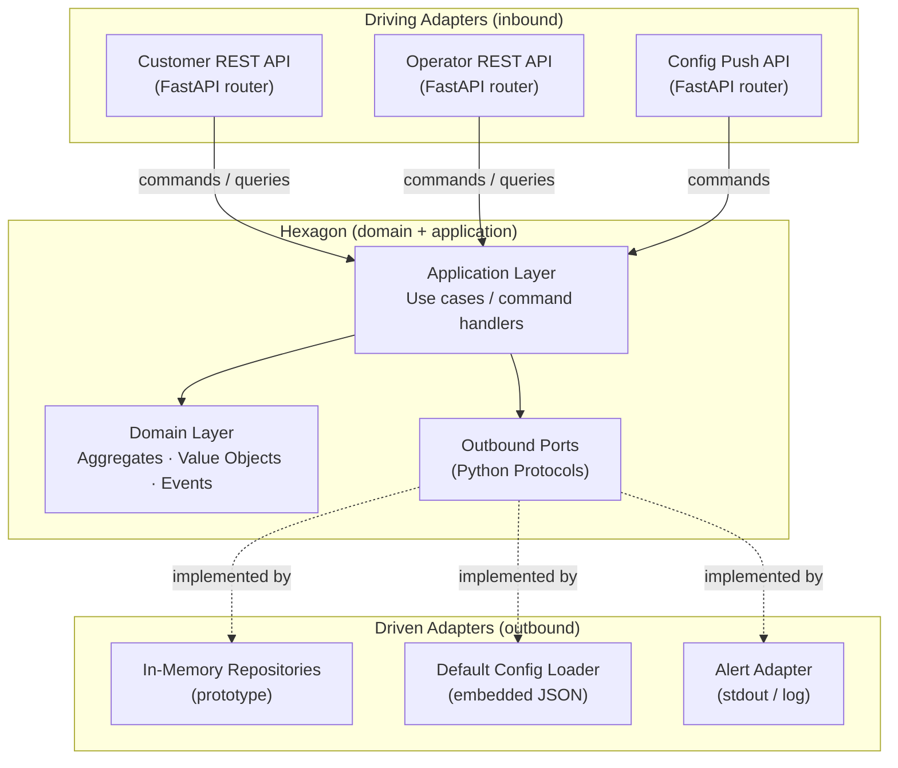
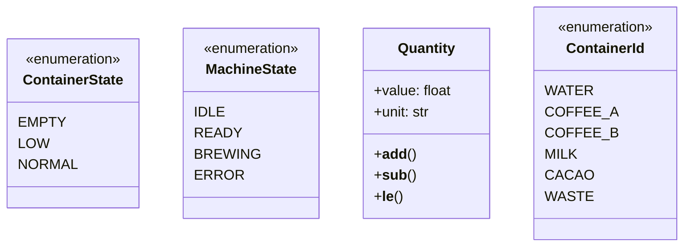
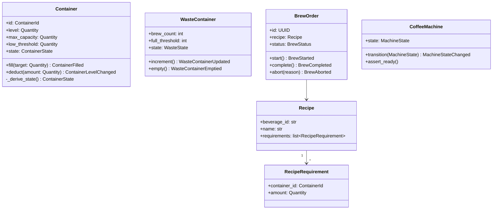
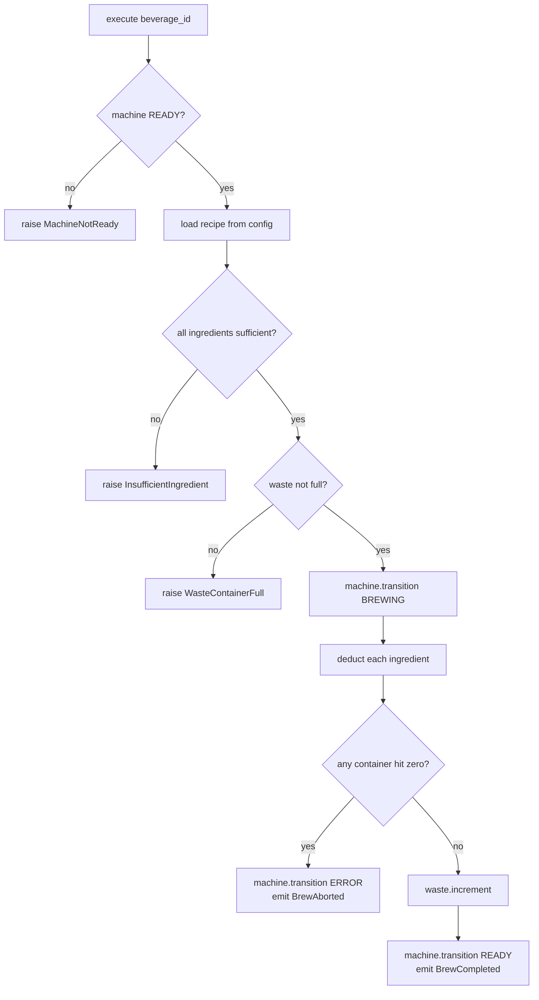

# Virtual Coffee Machine — System Design v1

> Python · Ports & Adapters · API-first · 2026-10-14

---

## 1. Architecture Overview

The application is structured as a **hexagonal (ports & adapters)** architecture. The **domain** and **application** layers form the hexagon — pure Python, zero framework dependencies. Everything outside is an adapter.



### Dependency rule
> Dependencies point **inward only**. The domain layer knows nothing about FastAPI, repositories, or any adapter.

---

## 2. Technology Stack

| Concern | Choice | Reason |
|---|---|---|
| Language | Python 3.12 | Type hints, `Protocol`, dataclasses |
| API framework | FastAPI | API-first, OpenAPI out of the box, async-ready |
| API schemas | Pydantic v2 | Validation, serialisation, clear contract |
| Port interfaces | `typing.Protocol` | Structural subtyping, no forced inheritance |
| Domain models | Python `dataclass` | Lightweight, no framework coupling |
| Prototype persistence | In-memory dict | Trivial swap for a real DB later |
| Testing | pytest + httpx | FastAPI test client, isolated unit tests |
| Config format | JSON (embedded) | Simple default config, easy to extend |

---

## 3. Module Structure

```
virtualcoffeemachine/
│
├── domain/                        # Pure domain — no imports outside this tree
│   ├── model/
│   │   ├── container.py           # Container aggregate
│   │   ├── waste_container.py     # WasteContainer aggregate
│   │   ├── brew_order.py          # BrewOrder aggregate
│   │   ├── recipe.py              # Recipe entity
│   │   ├── machine.py             # CoffeeMachine aggregate (state FSM)
│   │   └── value_objects.py       # ContainerState, Quantity, MachineState, …
│   └── events.py                  # Domain event dataclasses
│
├── application/                   # Orchestration — uses domain + outbound ports
│   ├── ports/
│   │   ├── container_repository.py   # ContainerRepository (Protocol)
│   │   ├── configuration_port.py     # ConfigurationPort (Protocol)
│   │   └── alert_port.py             # AlertPort (Protocol)
│   ├── use_cases/
│   │   ├── brew_beverage.py
│   │   ├── fill_container.py
│   │   ├── empty_waste.py
│   │   ├── apply_configuration.py
│   │   ├── get_container_state.py
│   │   └── get_active_configuration.py
│   └── machine_service.py         # Coordinates use cases, holds machine state
│
├── adapters/
│   ├── inbound/
│   │   ├── api/
│   │   │   ├── customer_router.py    # POST /beverages/brew, GET /beverages
│   │   │   ├── operator_router.py    # GET/PUT /containers, DELETE /waste
│   │   │   └── config_router.py      # POST /configuration
│   │   └── schemas/
│   │       ├── beverage_schemas.py
│   │       ├── container_schemas.py
│   │       └── configuration_schemas.py
│   └── outbound/
│       ├── in_memory_container_repository.py
│       ├── in_memory_brew_order_repository.py
│       ├── default_configuration_adapter.py   # loads default_config.json
│       └── log_alert_adapter.py
│
├── config/
│   └── default_config.json        # Default recipes + thresholds
│
├── main.py                        # FastAPI app, dependency wiring
└── tests/
    ├── unit/                      # Test domain + application in isolation
    └── integration/               # Test via FastAPI test client
```

---

## 4. Domain Layer

### 4.1 Value Objects



### 4.2 Aggregates



### 4.3 Domain Events

All events are plain `dataclass` instances raised by aggregates and returned to the application layer (no internal event bus in v1).

```python
# domain/events.py (illustrative)

@dataclass(frozen=True)
class BrewStarted:
    brew_order_id: UUID
    beverage_id: str

@dataclass(frozen=True)
class BrewCompleted:
    brew_order_id: UUID

@dataclass(frozen=True)
class BrewAborted:
    brew_order_id: UUID
    reason: str
    container_id: ContainerId | None

@dataclass(frozen=True)
class ContainerLow:
    container_id: ContainerId
    level: Quantity

@dataclass(frozen=True)
class ContainerEmpty:
    container_id: ContainerId

@dataclass(frozen=True)
class WasteContainerFull:
    brew_count: int
    threshold: int

@dataclass(frozen=True)
class ConfigurationApplied:
    source: str   # "remote" | "default"

@dataclass(frozen=True)
class ConfigurationRejected:
    reason: str
```

---

## 5. Application Layer — Ports (Outbound)

Ports are `Protocol` classes. Adapters implement them structurally — no base class required.

```python
# application/ports/container_repository.py
from typing import Protocol
from domain.model.container import Container
from domain.model.waste_container import WasteContainer
from domain.model.value_objects import ContainerId

class ContainerRepository(Protocol):
    def get(self, container_id: ContainerId) -> Container: ...
    def get_waste(self) -> WasteContainer: ...
    def save(self, container: Container) -> None: ...
    def save_waste(self, waste: WasteContainer) -> None: ...
    def list_all(self) -> list[Container]: ...
```

```python
# application/ports/configuration_port.py
from typing import Protocol
from domain.model.recipe import Recipe
from domain.model.value_objects import ContainerId, Quantity

class ConfigurationPort(Protocol):
    def get_recipe(self, beverage_id: str) -> Recipe: ...
    def get_all_recipes(self) -> list[Recipe]: ...
    def get_low_threshold(self, container_id: ContainerId) -> Quantity: ...
    def get_waste_full_threshold(self) -> int: ...
    def apply(self, payload: dict) -> None: ...
    def get_source(self) -> str: ...  # "remote" | "default"
```

```python
# application/ports/alert_port.py
from typing import Protocol
from domain.events import ContainerLow, ContainerEmpty, WasteContainerFull, BrewAborted

class AlertPort(Protocol):
    def on_container_low(self, event: ContainerLow) -> None: ...
    def on_container_empty(self, event: ContainerEmpty) -> None: ...
    def on_waste_full(self, event: WasteContainerFull) -> None: ...
    def on_brew_aborted(self, event: BrewAborted) -> None: ...
```

---

## 6. Application Layer — Use Cases

Each use case is a single callable class with one `execute()` method. Dependencies (ports) are injected via the constructor.

```mermaid
classDiagram
    class BrewBeverage {
        -containers: ContainerRepository
        -config: ConfigurationPort
        -machine: CoffeeMachine
        -alerts: AlertPort
        +execute(beverage_id) BrewResult
    }

    class FillContainer {
        -containers: ContainerRepository
        -config: ConfigurationPort
        -machine: CoffeeMachine
        +execute(container_id, target_level) ContainerState
    }

    class EmptyWaste {
        -containers: ContainerRepository
        -machine: CoffeeMachine
        +execute() None
    }

    class ApplyConfiguration {
        -config: ConfigurationPort
        -containers: ContainerRepository
        +execute(payload) ConfigResult
    }

    class GetContainerState {
        -containers: ContainerRepository
        +execute(container_id) ContainerStateView
    }

    class GetActiveConfiguration {
        -config: ConfigurationPort
        +execute() ConfigurationView
    }
```



### BrewBeverage flow



---

## 7. API Design

Base URL: `/api/v1`

### 7.1 Customer endpoints

| Method | Path | Description |
|---|---|---|
| `GET` | `/beverages` | List available beverages (from active config) |
| `POST` | `/beverages/brew` | Request a brew |

**POST /beverages/brew**
```json
// Request
{ "beverage_id": "espresso" }

// 200 OK
{ "status": "completed", "brew_order_id": "uuid" }

// 422 Unprocessable Entity
{ "error": "insufficient_ingredient", "container_id": "coffee_a", "required": 7, "available": 3 }

// 409 Conflict
{ "error": "machine_not_ready", "machine_state": "ERROR" }

// 409 Conflict
{ "error": "waste_container_full", "brew_count": 10, "threshold": 10 }
```

### 7.2 Operator endpoints

| Method | Path | Description |
|---|---|---|
| `GET` | `/containers` | List all containers and their state |
| `GET` | `/containers/{id}` | Get one container state |
| `PUT` | `/containers/{id}/fill` | Fill a container to a target level |
| `DELETE` | `/containers/waste` | Empty the waste container |

**GET /containers/{id}**
```json
// 200 OK
{
  "container_id": "water",
  "level": 450,
  "unit": "mL",
  "max_capacity": 1500,
  "low_threshold": 200,
  "state": "NORMAL"
}
```

**PUT /containers/{id}/fill**
```json
// Request
{ "target_level": 1500 }

// 200 OK
{ "container_id": "water", "level": 1500, "state": "NORMAL" }

// 422 Unprocessable Entity
{ "error": "exceeds_max_capacity", "max_capacity": 1500 }
```

### 7.3 Configuration endpoint

| Method | Path | Description |
|---|---|---|
| `POST` | `/configuration` | Push a new configuration |
| `GET` | `/configuration` | Get active configuration |

**POST /configuration**
```json
// Request
{
  "waste_full_threshold": 15,
  "thresholds": {
    "coffee_a": { "low": 30 },
    "water":    { "low": 300 }
  },
  "recipes": {
    "espresso": {
      "name": "Espresso",
      "requirements": { "water": 30, "coffee_a": 7 }
    }
  }
}

// 200 OK
{ "status": "accepted", "source": "remote" }

// 422 Unprocessable Entity
{ "status": "rejected", "reason": "low_threshold exceeds max_capacity for coffee_a" }
```

### 7.4 OpenAPI
FastAPI generates `/docs` (Swagger UI) and `/openapi.json` automatically. No extra tooling needed.

---

## 8. Dependency Wiring

Dependencies are assembled once in `main.py` and injected into use cases via FastAPI's `Depends`.

```python
# main.py (illustrative)

from fastapi import FastAPI
from adapters.outbound.in_memory_container_repository import InMemoryContainerRepository
from adapters.outbound.default_configuration_adapter import DefaultConfigurationAdapter
from adapters.outbound.log_alert_adapter import LogAlertAdapter
from application.machine_service import MachineService

app = FastAPI(title="Virtual Coffee Machine", version="1.0")

# Assemble adapters
container_repo = InMemoryContainerRepository()
config = DefaultConfigurationAdapter.load("config/default_config.json")
alerts = LogAlertAdapter()

# Assemble machine service (holds CoffeeMachine state)
machine_service = MachineService(container_repo, config, alerts)

# Mount routers
app.include_router(customer_router(machine_service), prefix="/api/v1")
app.include_router(operator_router(machine_service), prefix="/api/v1")
app.include_router(config_router(machine_service),   prefix="/api/v1")
```

No DI framework needed for the prototype — constructor injection is sufficient.

---

## 9. Key Design Decisions

### ADR-01 — `typing.Protocol` for ports, not `ABC`
**Decision:** Use `Protocol` (structural subtyping).
**Reason:** Adapters don't need to inherit from a base class. Any class that implements the right methods satisfies the port. Easier to test with simple stub objects.

### ADR-02 — Domain events returned, not published
**Decision:** Aggregates return domain events as values; the application layer dispatches them.
**Reason:** Avoids an event bus dependency in the domain. Simpler to test — events are just return values. An event bus can be added in v2 without touching the domain.

### ADR-03 — Single `MachineState` aggregate in the application layer
**Decision:** `CoffeeMachine` (the state FSM) lives in the domain but is held as a singleton by `MachineService` in the application layer.
**Reason:** There is exactly one machine. The application layer is the right owner for its lifecycle; the domain defines the valid state transitions.

### ADR-04 — In-memory storage for v1
**Decision:** All repositories are in-memory dicts seeded on startup.
**Reason:** Prototype speed. Swap the adapter to add SQLite or PostgreSQL later — the domain and application layers are unaffected.

### ADR-05 — Configuration as a driven port
**Decision:** The active configuration is accessed through `ConfigurationPort`, not imported directly.
**Reason:** Default config and remote config are two implementations of the same port. The application layer never knows which is active.

---

## 10. Testing Strategy

| Layer | Test type | Tools | What is stubbed |
|---|---|---|---|
| Domain (aggregates) | Unit | pytest | Nothing — pure functions |
| Application (use cases) | Unit | pytest | Port implementations (simple stubs) |
| Adapters (API) | Integration | pytest + httpx | None — full stack with in-memory adapters |

### Example unit test sketch
```python
def test_brew_aborts_when_ingredient_exhausted():
    # Arrange
    containers = StubContainerRepository(coffee_a_level=3)  # below recipe requirement
    config = StubConfigurationPort(espresso_requires_coffee_a=7)
    machine = CoffeeMachine()
    machine.transition(MachineState.READY)
    use_case = BrewBeverage(containers, config, machine, StubAlertPort())

    # Act / Assert
    with pytest.raises(InsufficientIngredient) as exc:
        use_case.execute("espresso")
    assert exc.value.container_id == ContainerId.COFFEE_A
```

---

## 11. What Is NOT in v1

| Concern | Deferred to |
|---|---|
| Real database (SQLite / Postgres) | v2 — swap the repository adapter |
| Remote config HTTP client (polling / push) | v2 — swap the config adapter |
| Authentication on any endpoint | v3 |
| Async brewing (long-running task) | v2 if needed |
| Multiple machine instances | Out of scope |
